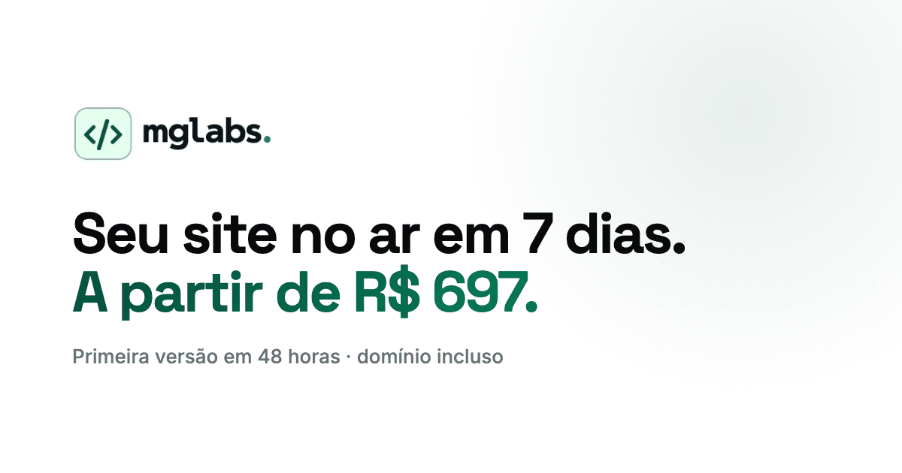

# mglabs

Landing page da **mglabs**, estúdio de design e desenvolvimento de sites: planos Essencial (R$ 697), Profissional (R$ 1.497) e MGLabs Custom (sob proposta).



Site estático em HTML, CSS e JavaScript puro, sem framework e sem etapa de build. Você edita o arquivo e atualiza o navegador.

## Seções

| Seção | O que mostra |
|---|---|
| Hero | Proposta de valor, CTA "Solicitar meu site" (WhatsApp), preço de entrada em segundo plano e a janela animada que monta o site |
| Diferenciais | Três promessas de marca |
| Projetos no ar | Cards com print, segmento, objetivo e solução: [HM2 Aviation](https://hm2aviation.com.br/), [Moraes Luz Advocacia](https://moraesluzadv.com/) e [João Castro Fit](https://joaocastro.fit/) |
| Planos | Essencial, Profissional (em destaque) e MGLabs Custom, cada um com mensagem própria no WhatsApp, e as condições comerciais (recolhidas no celular) |
| Do briefing à entrega | As 6 etapas da contratação, com CTA pro briefing |
| Pra quem é | Perfis de cliente com destaque rotativo |
| Quem faz | Bio, foto e links do fundador |
| CTA final | WhatsApp para site ou projeto sob medida |

## Rodando localmente

Não há dependências. Abra o `index.html` no navegador ou, para testar como se estivesse publicado, sirva a pasta:

```bash
python3 -m http.server 8000
# abra http://localhost:8000
```

## Estrutura

```
index.html            página única (todo o conteúdo)
style.css             estilos, organizados por seção
main.js               efeitos: entrada por scroll, destaque rotativo, brilho no cursor, barra de leitura
public/
  favicon.ico, favicon-32.png, apple-touch-icon.png, icon-192/512.png, site.webmanifest
  logo-mglabs.png     logo do menu e do rodapé (fundo transparente)
  mark-mglabs.png     símbolo </> usado no CTA final
  og-image.png        imagem que aparece ao compartilhar o link (1200×630)
  projetos/           prints otimizados do portfólio (.webp); os *-2/*-3 não estão em uso
  mg/                 retrato do "Quem faz"
  project */          prints originais dos projetos (fonte)
```

Os arquivos grandes (`logomglabs.png`, `faviconmglabs.png`, `project */*.png`, `mg/mageMG1.png`) são os **originais**. O site usa apenas as versões otimizadas geradas a partir deles.

## Editando o conteúdo

**Cores e fontes.** Ficam no `:root` do `style.css`. A cor da marca é definida por `--primary`, `--primary-hover` e `--primary-rgb`. As fontes são Space Grotesk (títulos) e Inter (texto), carregadas do Google Fonts.

**Preços.** Procure por `697` e `1.497` no `index.html` (descrição, hero e cards de `#planos`). As mensagens do WhatsApp de cada plano também citam o valor. A `public/og-image.png` ainda traz o texto antigo ("7 dias") dentro da imagem e precisa ser gerada de novo.

**WhatsApp.** Todos os botões usam `https://wa.me/5562981330312?text=…`, com a mensagem já preenchida (codificada para URL).

**Projetos do portfólio.** Cada projeto é um `<article class="obra-card">` dentro de `#trabalhos`, com um print, segmento, objetivo, solução e link. Para adicionar um projeto:

1. Converta o print da página inicial para WebP com 1200 px de largura:
   ```bash
   cwebp -q 80 -resize 1200 0 print.png -o public/projetos/projeto-1.webp
   ```
2. Copie um `<article class="obra-card">` existente e troque textos, links e imagem.

**Endereço na animação do hero.** Se trocar `seunegocio.com.br`, atualize também o `steps(17, end)` em `.lab-url-texto` no `style.css`. O 17 é o número de caracteres do endereço.

## Publicando

Por ser estático, funciona em qualquer hospedagem: GitHub Pages, Netlify, Vercel ou Cloudflare Pages.

**GitHub Pages:** Settings → Pages → Source: *Deploy from a branch* → `main` / `(root)`.

Depois de definir o domínio, troque o `og:image` e o `twitter:image` no `<head>` por uma URL absoluta (ex.: `https://seudominio.com.br/public/og-image.png`). WhatsApp, LinkedIn e Facebook não leem caminho relativo.

## Desempenho e acessibilidade

- As animações usam `transform` e `opacity` e pausam quando saem da tela.
- Tudo respeita `prefers-reduced-motion`: quem pede menos movimento vê a página parada, com o estado final.
- Sem JavaScript, a página continua completa. Os efeitos só animam o que já está no HTML.
- Imagens em WebP com `loading="lazy"`, e logo e ícones com paleta reduzida.

## Contato

**Miguel Luz**, Founder & Product Designer.
[LinkedIn](https://www.linkedin.com/in/miguelluz19) · [Instagram](https://www.instagram.com/miiguel.luz/) · [WhatsApp](https://wa.me/5562981330312)

© 2026 mglabs. Todos os direitos reservados.
